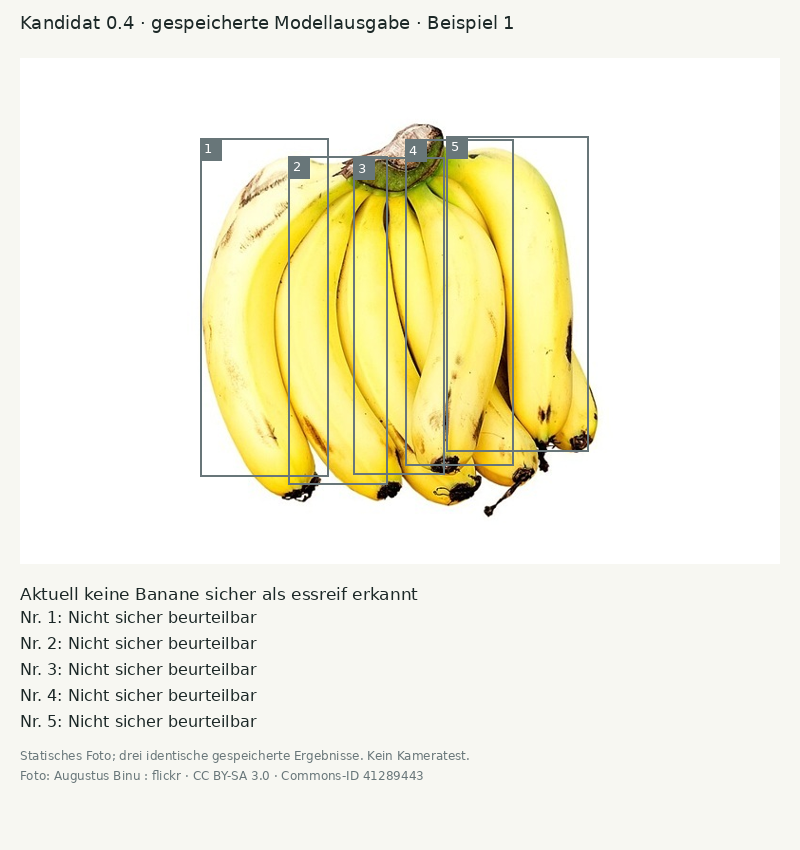
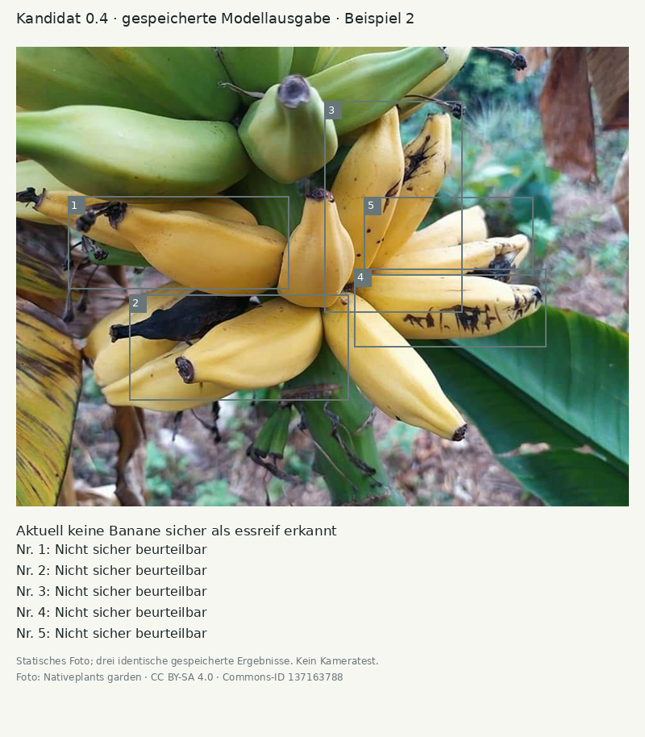
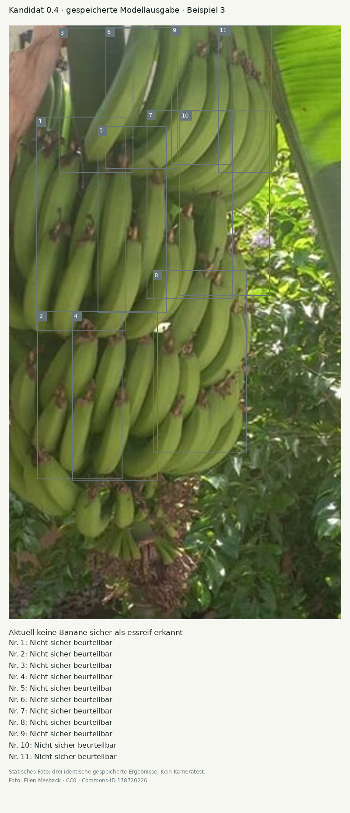

# Beispiele des Trainingsversuchs 0.4

Diese Abbildungen zeigen gespeicherte Ausgaben des Kandidaten auf drei vor der Testinferenz festgelegten Fotos. Sie sind keine Screenshots der öffentlichen App und keine Geräteprüfung. Die Nummern, drei Bestätigungen, Statuszeilen und Nummernpositionen verwenden die gleichen Funktionen wie die App. Es werden gespeicherte Detektionen dreimal ausgewertet; das Modell wird hier nicht erneut ausgeführt oder nachjustiert.

Gesamter Prüfbestand: **2 TP / 0 FP / 109 FN**. Die Beispiele ersetzen diese vollständige Auswertung nicht.

Modell-SHA-256: `9aa2bb21476b8b7b4e6fd8d79444e8971f15773e34204a8ae51f65c3a420f5d4`.

## 1. Cavendish bananas DS.jpg

Foto: Augustus Binu : flickr, [File:Cavendish bananas DS.jpg](https://commons.wikimedia.org/wiki/File:Cavendish_bananas_DS.jpg), [CC BY-SA 3.0](https://creativecommons.org/licenses/by-sa/3.0). Ausschnitt `[0, 0, 100, 100]` Prozent; verkleinert, Rahmen und Texte ergänzt. Die Abbildung verwendet dieselbe Bildlizenz.

## 2. Cavendish banana 2.jpg

Foto: Nativeplants garden, [File:Cavendish banana 2.jpg](https://commons.wikimedia.org/wiki/File:Cavendish_banana_2.jpg), [CC BY-SA 4.0](https://creativecommons.org/licenses/by-sa/4.0). Ausschnitt `[0, 0, 100, 100]` Prozent; verkleinert, Rahmen und Texte ergänzt. Die Abbildung verwendet dieselbe Bildlizenz.

## 3. UNRIPE BANANAS.jpg

Foto: Ellen Meshack, [File:UNRIPE BANANAS.jpg](https://commons.wikimedia.org/wiki/File:UNRIPE_BANANAS.jpg), [CC0](http://creativecommons.org/publicdomain/zero/1.0/deed.en). Ausschnitt `[38, 18, 70, 75]` Prozent; verkleinert, Rahmen und Texte ergänzt. Die Abbildung verwendet dieselbe Bildlizenz.
